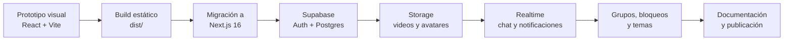

# 01 · Historia y evolución del proyecto

> **Cómo leer este documento.** El repositorio conserva **más de 50 commits** entre el 6 y el 10 de mayo de 2026, más los commits de documentación del 20 de octubre de 2026. No hay un diario de desarrollo, pero los mensajes de commit y los archivos que cambiaron permiten reconstruir el orden real de los hechos. La historia que sigue combina esa evidencia con la lectura del código; las inferencias se indican como tal. Las anécdotas personales (por qué lo empezaste, qué te costó más, qué sentiste al terminar) solo las puedes completar tú.

---

## 1. Resumen en una frase

**TikTokJonathan** empezó como una maqueta de interfaz para practicar React y terminó siendo una aplicación full-stack con autenticación, base de datos relacional, almacenamiento de archivos y chat en tiempo real.

## 2. Las dos etapas que se conservan

El repositorio contiene rastros de dos versiones distintas del mismo proyecto:

| Etapa | Qué se conserva | Evidencia |
| --- | --- | --- |
| **1. SPA con Vite** | `dist/` (build compilado) y el código completo en el primer commit | `dist/index.html` se titula *"TikTok Clone - Vite SPA"*; el bundle incluye React Router 7.15 y un cliente de Supabase con URL de marcador. El commit `01f196b` conserva `vite.config.js`, `index.html`, `src/pages/` y `src/components/`. |
| **2. Next.js App Router** | `src/` (código fuente actual) | `package.json` declara `next@^16.2.6`, scripts `next dev/build/start` y rutas en `src/app/`. |

La etapa 1 no está en el árbol de trabajo actual, pero **sí en el historial de Git**. Se puede recuperar con `git show 01f196b:package.json`, `git checkout 01f196b` o explorando el commit en GitHub. El build de esa etapa es el que se conserva en `dist/` para la demo estática. La etapa 2 es la que se puede ejecutar y modificar hoy.



## 3. Línea de tiempo

### 3.1. Cronología real (commits)

Los mensajes se conservan tal como se escribieron, con sus erratas y todo. Son la mejor prueba de cómo se vivió el desarrollo: hay días de euforia, correcciones de último minuto y algún que otro grito en mayúsculas.

| Fecha | Commit | Mensaje | Qué muestra |
| --- | --- | --- | --- |
| 2026-05-06 | `01f196b` | *Mi primer Commit* | La primera versión: React + Vite, `vite.config.js`, `index.html`, `src/pages/` y `src/components/`. |
| 2026-05-09 | `9b057eb` | *Implementacion de Register y Login.* | Primer salto a Next.js con `app/` en la raíz, autenticación y —por error— la carpeta `.next/` versionada. |
| 2026-05-09 | `f194d81` | *Corregion de pasar a Next.js* | Ajuste de despliegue: `vercel.json`. |
| 2026-05-09 | `f3c1c4d` | *Correccion del servidor fallo 500* | Primeros choques con el despliegue. |
| 2026-05-09 | `1e03343` | *espero no arrepentirme, dure horas.* | Reestructuración a `src/`, `next.config.mjs` y la base de la versión actual. |
| 2026-05-09 | `e7a7a8d` | *Cambiar el logito de la pestaña.* | Identidad visual y favicon. |
| 2026-05-10 | `4f49443` | *cambio en el SQL y tablas de servidor* | Esquema, tablas y políticas. |
| 2026-05-10 | `86c36a2` / `7ab7df5` | *Solucion del problema de subir videos.* / *Correcion de Onchange...* | Subida de archivos y formularios. |
| 2026-05-10 | `05dfdd0` | *Implementacion de la cosas de like, comentarios...* | Interacciones sociales del feed. |
| 2026-05-10 | `0673f6f` | *feat: sistema de vistas, modo oscuro y limpieza total del repositorio* | Contador de vistas, tema oscuro y limpieza de artefactos. |
| 2026-05-10 | `6cb10b4` | *feat: rediseño premium de UI, nuevas animaciones...* | El salto visual hacia una interfaz más pulida. |
| 2026-05-10 | `45bf068` | *feat: sistema de chat, bloqueo, seguidores/siguiendo...* | Chat, bloqueos y grafo social. |
| 2026-05-10 | `a33f6b3` | *feat: add comprehensive social features...* | Notificaciones, grupos, swipe, explorar y lightbox. |
| 2026-05-10 | `91d31ed` | *fix: resolve chat UI alignment... group creation RLS policy* | Ajustes de chat y RLS de grupos. |
| 2026-05-10 | `1254980` | *fix: resolve search bug silently failing on Postgres .or relation query* | El bug de búsqueda que se documenta en el roadmap. |
| 2026-05-10 | `db39936` | *feat: implement infinite loop scrolling wrap for video feed page* | Scroll infinito del feed. |
| 2026-05-10 | `d1193b7` | *feat: add delete button directly in VideoCard for mobile accessibility* | Accesibilidad móvil y borrado de videos. |
| 2026-10-20 | `ccbc08b` | *docs: README del proyecto y configuración de entorno* | README, `.env.example` y sanitización de `test_db.cjs`. |

> El 10 de mayo se concentra la mayor parte del trabajo: más de 40 commits en un solo día. No es que el proyecto se hiciera en 24 horas; es que ese día se integró y se pulió buena parte de lo que ya venía cocinándose.

### 3.2. Fases temáticas

| Fase | Qué se hizo | Huella en el código |
| --- | --- | --- |
| **1. Maqueta** | Pantallas de feed, perfil, login y explorar con datos falsos. | `src/data/videos.js`, posters de Picsum, videos de W3Schools y avatares de DiceBear. |
| **2. Sistema visual** | Paleta oscura, rojo TikTok, tipografía Inter y utilidades responsive. | `src/index.css`, tokens `--color-tiktok-*`, clases `tiktok-red`, `tiktok-black`. |
| **3. Shell** | Barra lateral de escritorio, navegación inferior móvil y layout de altura completa. | `ClientLayout.jsx`, `Sidebar.jsx` (`Sidebar`, `BottomNav`, `Logo`). |
| **4. Autenticación** | Registro, login, sesión persistente y contexto global. | `SessionProvider.jsx`, `login/page.jsx`, `register/page.jsx`, `handle_new_user` en el esquema. |
| **5. Feed** | Scroll vertical tipo TikTok, autoplay, doble toque, comentarios y guardados. | `page.jsx`, `VideoCard.jsx`. |
| **6. Backend** | Tablas, RLS, RPC, storage y realtime. | `supabase/schema.sql`. |
| **7. Perfil social** | Edición de perfil, avatares, seguidores, seguidos, bloqueos y favoritos. | `profile/[username]/page.jsx`, `EditProfileModal.jsx`, tablas `followers`, `blocks`, `saves`. |
| **8. Subida de videos** | Formulario con vista previa, categoría y almacenamiento público. | `upload/page.jsx`, buckets `videos` y `avatars`. |
| **9. Mensajería** | Chats directos y grupos con realtime, edición y borrado. | `chat/page.jsx`, `chat/[userId]/page.jsx`, `chat/group/[groupId]/page.jsx`. |
| **10. Notificaciones** | Bandeja, badges de no leídos y suscripciones en vivo. | `notifications/page.jsx`, `Sidebar.jsx`, tabla `notifications`. |
| **11. Temas y pulido** | Modo claro/oscuro persistente, animaciones, estados vacíos y responsive. | `ThemeContext.jsx`, clases `animate-*`, `pb-safe`. |
| **12. Publicación** | Build estático en GitHub Pages y documentación. | `dist/`, `docs/`, este repositorio. |

### 3.3. Nota sobre las fechas

Las fechas ya no son una incógnita: los commits van del **6 al 10 de mayo de 2026** y el commit de documentación es del **20 de octubre de 2026**. La actividad se concentró en cinco días, con un pico enorme el 10 de mayo. El JWT de la instancia de Supabase que aparecía en el script local original fue emitido en **marzo de 2026**, lo que sugiere que la cuenta y el backend se crearon antes del primer commit.

Son fechas de autor y de committer; si el historial se importó desde otro repositorio, pueden no coincidir con el día exacto de cada cambio. Aun así, son la evidencia más precisa que existe. Si recuerdas otras fechas, este es el lugar para corregirlas.

## 4. Cómo se construyó, paso a paso técnico

Esta sección reconstruye el "cómo lo hice" a partir de las decisiones visibles en el código. Es útil para entender el orden mental del proyecto y para replicarlo.

### 4.1. Elegir el stack

La primera versión usó **React + Vite** porque es la forma más rápida de arrancar una SPA: servidor de desarrollo instantáneo, recarga en caliente y un build estático fácil de publicar. El commit `01f196b` lo deja claro: `vite.config.js`, `index.html` y páginas en `src/pages/`.

Cuando el proyecto creció (rutas anidadas, layouts, metadata, optimización), se migró a **Next.js con App Router**, que ofrece enrutado por carpetas y un layout raíz compartido. La migración aparece en los commits del 9 de mayo (`9b057eb`, `f194d81`) y se consolida en `1e03343`, el commit que introduce `src/app/` y `next.config.mjs`; ese es el esqueleto de la versión actual.

Del paso por Vite quedaron dos rastros:

- El build en `dist/`, que se usa para la demo de GitHub Pages.
- La dependencia `@tailwindcss/vite` en `package.json`, que ya no se usa en la versión Next.js.

### 4.2. Montar el sistema de diseño

Antes de las pantallas se definieron los tokens en `src/index.css`:

- Rojo de marca `#FE2C55`.
- Fondo principal `#010101` y superficies `#121212`.
- Texto principal blanco y secundario `#8A8A8E`.
- Variables CSS para que el tema claro sobrescriba los mismos nombres.

Tailwind 4 se configuró con `@import "tailwindcss"` y el bloque `@theme`, sin archivo `tailwind.config.js`. Esa es la razón de que los colores se usen como `bg-tiktok-red` o `text-tiktok-gray`.

### 4.3. Construir el shell de navegación

`ClientLayout.jsx` es el corazón estructural:

- Detecta si la ruta es un chat (`/chat/algo`) para ocultar la barra inferior en móvil.
- Monta `Sidebar` en escritorio y `BottomNav` en móvil.
- Envuelve todo en `ThemeProvider`.
- Usa `h-screen w-screen` y `overflow-hidden` para que el scroll ocurra dentro del contenido, no en la página.

El logo se implementó como un SVG inline dentro de `Sidebar.jsx` (`Logo`), con un gradiente cian → rojo. El mismo trazado se copió a `src/app/icon.svg` para el favicon.

### 4.4. Integrar Supabase

El cliente vive en `src/utils/supabase.js` y se crea una sola vez:

```js
export const supabase = createClient(supabaseUrl, supabaseKey)
```

Las credenciales se leen de `NEXT_PUBLIC_SUPABASE_URL` y `NEXT_PUBLIC_SUPABASE_ANON_KEY`, con valores de marcador para que la app no explote si faltan. Esa decisión permite que el build compile sin un `.env`, a costa de que las consultas fallen en silencio y el feed caiga en los datos de ejemplo.

### 4.5. Modelar la base de datos

El esquema se escribió como un único `supabase/schema.sql` reproducible. El orden es deliberado:

1. Extensión `uuid-ossp`.
2. Tablas base (`profiles`, `categories`, `videos`).
3. Tablas sociales (`likes`, `saves`, `comments`, `followers`).
4. RLS de cada tabla.
5. Trigger que crea el perfil al registrarse.
6. Buckets y políticas de storage.
7. Funciones RPC.
8. Tablas de bloqueos, mensajes, notificaciones y grupos.
9. Realtime y storage de chat.

Tener todo en un archivo facilitó reconstruir el backend desde cero en un proyecto nuevo de Supabase.

### 4.6. Implementar la autenticación

`SessionProvider` hace dos cosas:

- Pide la sesión actual con `supabase.auth.getSession()`.
- Se suscribe a `onAuthStateChange` para mantener el contexto actualizado.

Con eso, cualquier componente puede llamar a `useSession()` y saber si hay usuario. Las páginas de login y registro usan `signInWithPassword` y `signUp`, y el nombre de usuario viaja en `options.data.username`, que el trigger `handle_new_user` copia a `profiles.username`.

### 4.7. Construir el feed

El feed es el componente más complejo del proyecto. Combina:

- **Estado local** para el índice activo, el tab y la lista de videos.
- **Consulta a Supabase** con `select('*, profiles(username, avatar_url)')`.
- **Fallback** a `VIDEOS` cuando la consulta no devuelve filas.
- **Scroll snap** nativo (`snap-y snap-mandatory`) y navegación programática con `scrollIntoView`.
- **Rueda del ratón** interceptada para pasar de video, ignorando inputs y formularios.
- **Gestos táctiles** con un umbral de 50 px.
- **Autoplay** del video activo, con intento de reproducción sin sonido si el navegador lo bloquea.

El contador de vistas se incrementa a los 3 segundos con `supabase.rpc('increment_view')`, y si la RPC falla se intenta un `update` clásico.

### 4.8. Construir el reproductor social

`VideoCard.jsx` concentra la interacción social:

- Like con actualización optimista y animación.
- Doble toque con corazón flotante.
- Comentarios en panel lateral (escritorio) o *bottom sheet* (móvil).
- Guardado en `saves`.
- Seguir/dejar de seguir desde el avatar.
- Compartir copiando el enlace.
- Borrar el video si eres el dueño.
- Control de volumen y barra de progreso.

Cada acción escribe en Supabase y, cuando corresponde, inserta una notificación para el autor.

### 4.9. Añadir explorar, perfil y subida

- **Explorar** combina búsqueda con *debounce*, tendencias por vistas, categorías con scroll infinito y usuarios sugeridos.
- **Perfil** resuelve el caso especial `me`, carga estadísticas con consultas `count`, muestra favoritos y permite bloquear usuarios.
- **Subida** valida que haya archivo, lo sube al bucket `videos`, obtiene la URL pública e inserta la fila.

### 4.10. Añadir mensajería y notificaciones

La mensajería fue la parte que más empujó el proyecto hacia "app real":

- `get_conversations` resume la última conversación por usuario con una *window function*.
- Los mensajes se insertan de forma optimista y se reconcilian con la respuesta de Supabase.
- Realtime mantiene la lista y el chat actualizados.
- Los grupos añaden `chat_groups`, `group_members` y `group_messages`.
- Las notificaciones se crean desde el cliente al dar like, comentar, seguir o enviar un mensaje.

### 4.11. Pulir la experiencia

Al final se añadieron detalles que no cambian la funcionalidad pero sí la sensación de producto:

- Tema claro/oscuro persistente.
- Animaciones de entrada, *toasts* y estados vacíos con personalidad.
- Navegación adaptativa escritorio/móvil.
- `pb-safe` para el *notch* de iOS.
- Microinteracciones en botones (`hover:scale`, `active:scale`).

## 5. Decisiones técnicas y sus consecuencias

| Decisión | Por qué se intuye | Consecuencia |
| --- | --- | --- |
| Cliente puro, sin API Routes | Todas las páginas llevan `"use client"` y llaman a Supabase directamente. | Menos código y despliegue simple; la seguridad depende al 100 % de RLS. |
| Supabase como backend | Auth, Postgres, Storage y Realtime en un solo servicio. | Menos infraestructura; acoplamiento al SDK y a las políticas SQL. |
| Tailwind 4 sin config JS | `@import "tailwindcss"` y `@theme` en CSS. | Tokens centralizados; algunas utilidades personalizadas quedaron sin definir. |
| JavaScript en vez de TypeScript | Todos los archivos son `.jsx`. | Iteración rápida; menos garantías y más errores en tiempo de ejecución. |
| Datos de ejemplo como fallback | `VIDEOS` se usa cuando la consulta no devuelve filas. | La demo siempre se ve poblada; puede ocultar un backend mal configurado. |
| Un único `schema.sql` | Todo el backend es reproducible. | Fácil de reconstruir; requiere cuidado al reejecutar por políticas duplicadas. |
| `dist/` versionado | Es el único build de la etapa Vite. | Permite una demo estática; queda desactualizado respecto al código Next.js. |

## 6. Qué áreas demuestra el proyecto

Más que una lista de tecnologías, el código muestra práctica en:

- **Diseño de interfaces:** jerarquía visual, modo oscuro, responsive, estados vacíos y microinteracciones.
- **Modelado de datos:** relaciones, claves compuestas, cascadas, *window functions* y contadores atómicos.
- **Seguridad:** políticas RLS por tabla, separación de roles y uso de la clave pública.
- **Tiempo real:** canales de Postgres Changes y reconciliación de estado.
- **Manejo de archivos:** buckets públicos, rutas por usuario y URLs firmadas/públicas.
- **Producto:** flujos de registro, feed, perfil, chat y notificaciones conectados entre sí.

## 7. Tu historia personal

Este documento no inventa motivaciones ni anécdotas. Si quieres completarlo, estos son buenos puntos de partida:

- ¿En qué año y con qué objetivo empezaste el proyecto?
- ¿Qué fue lo primero que construiste y qué fue lo que más te costó?
- ¿Por qué decidiste migrar de Vite a Next.js?
- ¿Qué aprendiste de Supabase que no sabías antes?
- ¿Qué harías distinto si empezaras hoy?

Puedes añadir tus respuestas en esta sección sin tocar el resto del documento.

## 8. Fuentes consultadas

| Afirmación | Archivo |
| --- | --- |
| Existió una versión Vite | `dist/index.html`, `dist/assets/index-BwS1EQeN.js` |
| La versión actual es Next.js 16 | `package.json`, `src/app/layout.jsx` |
| Tailwind 4 y tokens de diseño | `src/index.css`, `postcss.config.mjs` |
| Autenticación con Supabase | `src/app/SessionProvider.jsx`, `src/app/login/page.jsx` |
| Modelo de datos y RLS | `supabase/schema.sql` |
| Chat y grupos | `src/app/chat/**`, tablas `messages`, `chat_groups`, `group_members`, `group_messages` |
| Notificaciones | `src/app/notifications/page.jsx`, tabla `notifications` |
| Logo y favicon | `src/app/icon.svg`, `src/components/Sidebar.jsx`, `dist/favicon.svg` |
| Fechas, orden y mensajes de desarrollo | Historial de Git: `git log --reverse --format='%h %ad %s' --date=short`; commits citados en §3.1 |

---

Siguiente: [02 · Arquitectura](02-arquitectura.md) · Volver al [índice](README.md).
