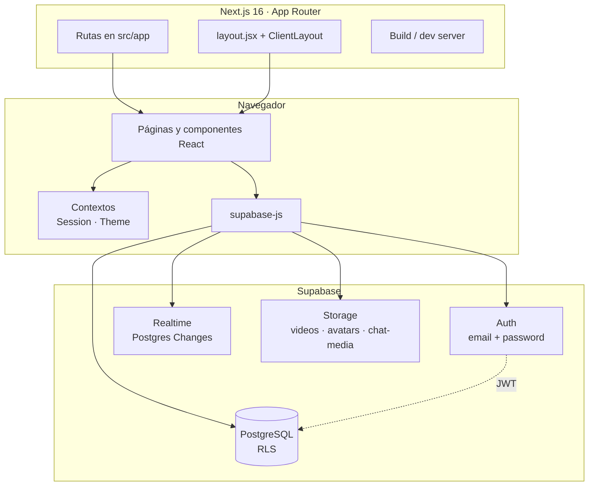
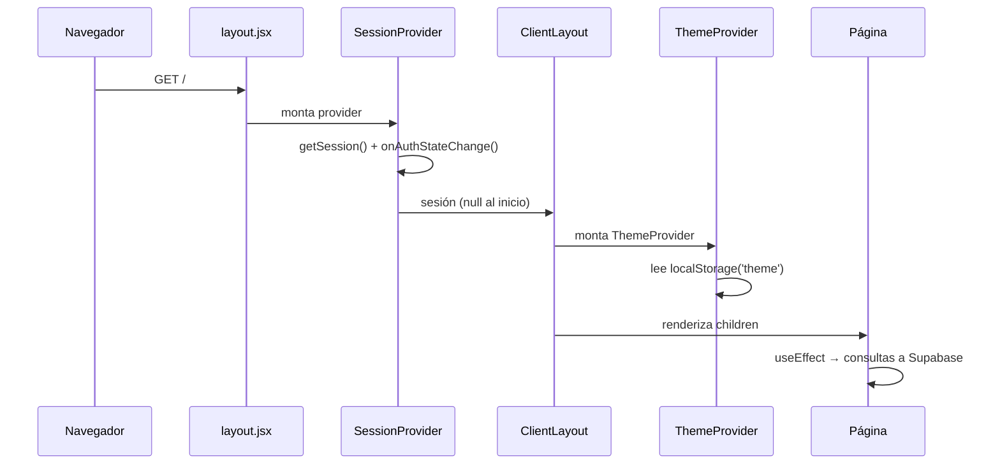
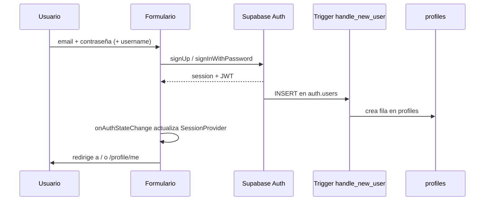
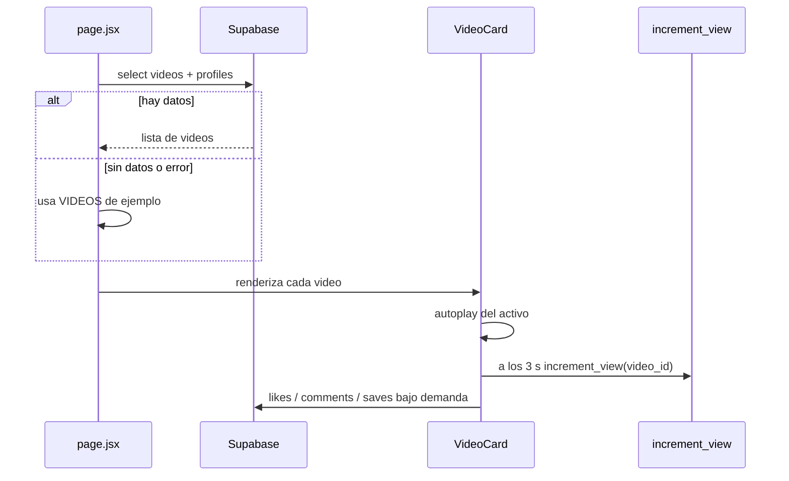
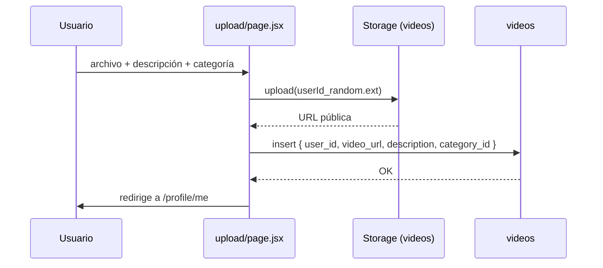
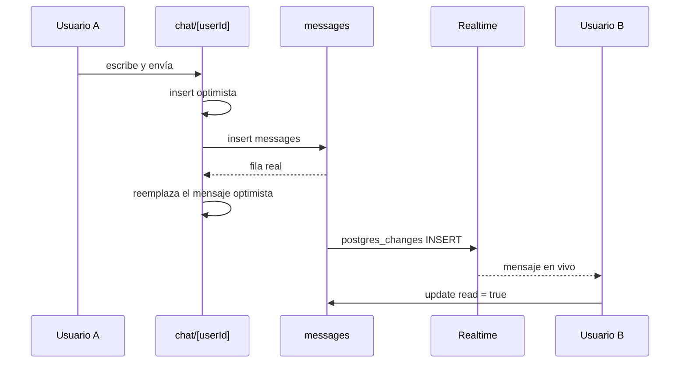

# 02 · Arquitectura

Este documento explica cómo está organizada la aplicación, cómo fluyen los datos y por qué se tomaron las decisiones que se ven en el código.

---

## 1. Visión general

TikTokJonathan es una aplicación **client-first** construida con Next.js 16 (App Router) que consume **Supabase** directamente desde el navegador. No hay API Routes, Server Actions ni un backend propio: Next.js se encarga del enrutado, el layout y el build; Supabase se encarga de la autenticación, la base de datos, el almacenamiento y el tiempo real.



### Principios que se deducen del código

1. **El cliente manda.** Todas las páginas llevan `"use client"` y hacen sus consultas en `useEffect`.
2. **La seguridad vive en la base de datos.** El cliente usa la clave `anon`; las políticas RLS deciden qué puede leer y escribir cada usuario.
3. **Un solo servicio para el backend.** Auth, datos, archivos y realtime están en Supabase.
4. **Estado global mínimo.** Solo la sesión y el tema son globales; el resto es estado local de cada página.
5. **Diseño dark-first.** El tema oscuro es el valor por defecto y el claro es una variante.

---

## 2. Capas

| Capa | Ubicación | Responsabilidad |
| --- | --- | --- |
| **Rutas** | `src/app/**/page.jsx` | Componer la pantalla, cargar datos, manejar navegación. |
| **Shell** | `src/app/layout.jsx`, `ClientLayout.jsx` | HTML raíz, providers, sidebar, bottom nav. |
| **Estado global** | `src/app/SessionProvider.jsx`, `src/context/ThemeContext.jsx` | Sesión de Supabase y tema visual. |
| **Componentes** | `src/components/` | Piezas reutilizables con lógica de presentación e interacción. |
| **Acceso a datos** | `src/utils/supabase.js` | Cliente único de Supabase. |
| **Backend** | `supabase/schema.sql` | Tablas, RLS, RPC, triggers, storage y realtime. |
| **Datos de ejemplo** | `src/data/videos.js` | Fallback visual cuando no hay filas. |

No existe una capa de repositorios ni de casos de uso: las páginas llaman a `supabase.from(...)` directamente. Es una decisión adecuada para el tamaño actual, pero es el primer punto a refactorizar si el proyecto crece.

---

## 3. Arranque de la aplicación



Puntos importantes:

- `layout.jsx` es el único componente de servidor relevante: define metadata y envuelve la app.
- `SessionProvider` arranca con `session = null`. **No expone un estado de carga**, lo que provoca una carrera en las páginas que redirigen si no hay sesión (ver [limitaciones](../docs/09-limitaciones-y-roadmap.md)).
- `ThemeProvider` aplica la clase `light` o `dark` a `<html>` después del montaje, para evitar parpadeos en el HTML inicial.

---

## 4. Mapa de rutas

| Ruta | Archivo | Tipo | Descripción |
| --- | --- | --- | --- |
| `/` | `src/app/page.jsx` | Client | Feed vertical con tabs Para mí / Siguiendo. |
| `/explore` | `src/app/explore/page.jsx` | Client | Búsqueda, tendencias, categorías y usuarios. |
| `/login` | `src/app/login/page.jsx` | Client | Inicio de sesión con email y contraseña. |
| `/register` | `src/app/register/page.jsx` | Client | Registro con nombre de usuario. |
| `/upload` | `src/app/upload/page.jsx` | Client | Subida de video a Storage + tabla. |
| `/profile/me` | `src/app/profile/[username]/page.jsx` | Client | Alias que resuelve el perfil del usuario actual. |
| `/profile/[username]` | `src/app/profile/[username]/page.jsx` | Client | Perfil público o propio. |
| `/profile/[username]/followers` | `.../followers/page.jsx` | Client | Lista de seguidores con búsqueda. |
| `/profile/[username]/following` | `.../following/page.jsx` | Client | Lista de seguidos con búsqueda. |
| `/video/[id]` | `src/app/video/[id]/page.jsx` | Client | Reproductor individual con navegación entre videos. |
| `/chat` | `src/app/chat/page.jsx` | Client | Lista de conversaciones y grupos. |
| `/chat/[userId]` | `src/app/chat/[userId]/page.jsx` | Client | Mensaje directo con un usuario. |
| `/chat/group/[groupId]` | `src/app/chat/group/[groupId]/page.jsx` | Client | Chat de grupo con panel de información. |
| `/notifications` | `src/app/notifications/page.jsx` | Client | Bandeja de notificaciones. |

### Rutas dinámicas

- `[username]`: se usa tanto para perfiles públicos como para `me`. La página resuelve `me` consultando el `username` del usuario autenticado.
- `[id]`: identifica un video. La página carga todos los videos y busca el índice del solicitado.
- `[userId]`: identifica al otro participante de un mensaje directo.
- `[groupId]`: identifica un grupo.

---

## 5. Flujos principales

### 5.1. Autenticación



- El registro envía `username` en `options.data`; el trigger lo copia a `profiles.username`.
- Si no hay username, el trigger genera `user_<8 caracteres del UUID>`.
- La sesión se persiste en el almacenamiento del navegador que usa `supabase-js` (localStorage por defecto).
- El cierre de sesión se hace con `supabase.auth.signOut()`.

### 5.2. Feed



- El feed carga **todos** los videos ordenados por `created_at`; no hay paginación.
- El tab **Siguiendo** primero consulta `followers` y luego filtra los videos por `user_id`.
- El fallback a datos de ejemplo solo se activa si no hay filas o si la consulta devuelve error sin datos.

### 5.3. Subida de video



- El archivo se sube antes de insertar la fila. Si la inserción falla, el archivo queda huérfano en Storage.
- No se valida el tamaño real ni el tipo MIME en el cliente; solo el atributo `accept` y que el archivo exista.
- El nombre del archivo usa `Math.random()`, no un identificador determinista.

### 5.4. Mensajería directa



- La lista de conversaciones se obtiene con la RPC `get_conversations`.
- El chat se suscribe a **todos** los cambios de `messages` y filtra por los participantes en el cliente.
- Los mensajes se pueden editar (`edited = true`) y borrar lógicamente (`deleted = true`).

### 5.5. Notificaciones

- Se insertan desde el cliente cuando alguien da like, comenta, sigue o envía un mensaje.
- La barra lateral y la barra inferior se suscriben a `notifications` para actualizar el badge.
- La página de notificaciones marca como leídas al cargar.
- No hay Edge Functions ni triggers de base de datos para generarlas.

---

## 6. Estado y datos

### Estado global

| Estado | Dónde vive | Persistencia |
| --- | --- | --- |
| Sesión | `SessionProvider` | Supabase (localStorage del SDK). |
| Tema | `ThemeContext` | `localStorage['theme']`. |
| Badge de notificaciones | `Sidebar` y `BottomNav` | Memoria; se recalcula al montar. |

### Estado local

Cada página maneja sus listas, formularios, modales y errores con `useState`. No hay caché compartida ni normalización de entidades. Esto implica consultas repetidas entre pantallas, pero mantiene el código fácil de seguir.

### Consultas típicas

```js
// Feed con perfil del autor
const { data } = await supabase
  .from('videos')
  .select('*, profiles(username, avatar_url)')
  .order('created_at', { ascending: false })

// Contadores exactos sin traer filas
const { count } = await supabase
  .from('likes')
  .select('*', { count: 'exact', head: true })
  .eq('video_id', videoId)

// Búsqueda de usuarios
const { data } = await supabase
  .from('profiles')
  .select('*')
  .or(`username.ilike.%${query}%,full_name.ilike.%${query}%`)
```

---

## 7. Realtime

| Canal | Dónde | Escucha | Propósito |
| --- | --- | --- | --- |
| `sidebar_notifications` | `Sidebar.jsx` | INSERT/UPDATE en `notifications` del usuario | Badge lateral. |
| `bottom_notifications` | `Sidebar.jsx` (`BottomNav`) | INSERT/UPDATE en `notifications` del usuario | Badge móvil. |
| `chat_list_changes` | `chat/page.jsx` | INSERT en `messages` (receptor) y `group_messages` | Refrescar lista de chats. |
| `chat_<idA>_<idB>` | `chat/[userId]/page.jsx` | Todos los cambios en `messages` | Mensajes en vivo. |
| `group_<groupId>` | `chat/group/[groupId]/page.jsx` | `group_messages`, `chat_groups`, `group_members` | Chat y metadata del grupo. |
| `notifications_page` | `notifications/page.jsx` | INSERT en `notifications` del usuario | Añadir notificaciones en vivo. |

Los canales se eliminan en el `return` del `useEffect` con `supabase.removeChannel(channel)`. Es importante mantener esa limpieza al añadir nuevas suscripciones.

---

## 8. Storage

| Bucket | Público | Uso | Ruta típica |
| --- | --- | --- | --- |
| `videos` | Sí | Videos subidos por usuarios. | `<userId>_<random>.mp4` |
| `avatars` | Sí | Fotos de perfil. | `<profileId>/<random>.<ext>` |
| `chat-media` | Sí | Avatares de grupos y media de chat. | `groups/<groupId>/avatar_<timestamp>.png` |

Las políticas permiten lectura pública y escritura solo al propietario (`auth.uid() = owner`). No hay limpieza de archivos huérfanos cuando se borra un video, un avatar o un grupo.

---

## 9. Manejo de errores y estados

| Situación | Comportamiento actual |
| --- | --- |
| Falta configuración de Supabase | El cliente apunta a `placeholder.supabase.co`; las consultas fallan y el feed cae en datos de ejemplo. |
| Consulta sin filas | Se muestran estados vacíos o datos de ejemplo según la pantalla. |
| Error de login/registro | Se muestra el mensaje de Supabase en un bloque rojo. |
| Error al subir | Se muestra `err.message` en un bloque rojo. |
| Acción social sin sesión | `showToast('Inicia sesión para...')` en el reproductor; redirección en perfil. |
| Error de red en realtime | No hay reconexión explícita; `supabase-js` gestiona reintentos internos. |

No hay un sistema centralizado de *toasts*, logging ni reporte de errores. Cada componente resuelve su feedback como puede.

---

## 10. Decisiones, ventajas y riesgos

### Ventajas

- **Menos infraestructura:** un solo proveedor para auth, datos, archivos y realtime.
- **Iteración rápida:** no hay que escribir endpoints para cada consulta.
- **Seguridad declarativa:** RLS permite razonar sobre permisos por tabla.
- **Despliegue simple:** el frontend puede ir a Vercel o cualquier hosting estático; Supabase queda aparte.

### Riesgos

- **Confianza total en RLS:** un error de política expone datos. Ver la sección de seguridad del [roadmap](09-limitaciones-y-roadmap.md).
- **Lógica de negocio en el cliente:** notificaciones, contadores y validaciones se pueden manipular.
- **Sin tipos:** los errores de esquema se descubren en ejecución.
- **Sin tests:** los cambios se validan a mano.
- **Acoplamiento al SDK:** migrar de backend exigiría tocar todas las páginas.
- **Carrera de sesión:** las páginas que redirigen sin esperar a `getSession()` pueden expulsar a usuarios autenticados.

---

## 11. Dónde ampliar

| Quiero... | Dónde tocar |
| --- | --- |
| Añadir una pantalla | `src/app/<ruta>/page.jsx` + enlace en `Sidebar.jsx`. |
| Añadir un ítem de navegación | `NAV` de `Sidebar` y `BottomNav`. |
| Añadir una tabla | `supabase/schema.sql` + políticas RLS + consultas. |
| Añadir una función atómica | `CREATE FUNCTION` en `schema.sql` + `supabase.rpc(...)`. |
| Cambiar colores | `src/index.css` (`@theme`, `:root`, `.light`). |
| Añadir un componente | `src/components/` con `"use client"` si usa hooks. |
| Añadir realtime | `supabase.channel(...).on('postgres_changes', ...)` y limpiar en el `return`. |
| Añadir tipos | Migrar a TypeScript o generar tipos con `supabase gen types`. |

---

Siguiente: [03 · Estructura](03-estructura.md) · Volver al [índice](README.md).
