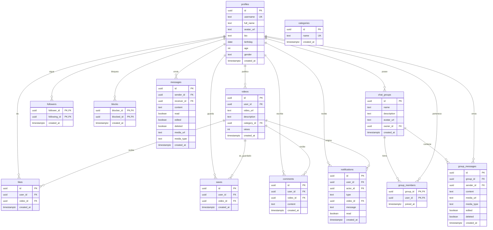

# 04 · Base de datos

Toda la persistencia vive en **PostgreSQL** dentro de Supabase. El esquema completo está en [`supabase/schema.sql`](../supabase/schema.sql) y se ejecuta una vez en el SQL Editor del proyecto.

Este documento explica qué hay, cómo se relaciona y qué permisos tiene cada tabla. **Léelo antes de cambiar cualquier política RLS.**

---

## 1. Cómo aplicar el esquema

1. Crea un proyecto en [Supabase](https://supabase.com/).
2. Ve a **SQL Editor → New query**.
3. Pega el contenido completo de `supabase/schema.sql`.
4. Ejecuta.
5. Verifica en **Table Editor** que aparecen las tablas y en **Storage** que existen los buckets `videos`, `avatars` y `chat-media`.

> **Recomendación:** usa un proyecto nuevo o una base vacía. El script no está pensado para reejecutarse sin errores: varias políticas de `storage` y `notifications` no usan `DROP POLICY IF EXISTS`, y algunas tablas no tienen `IF NOT EXISTS` en sus políticas. Ver [§9](#9-notas-de-esquema-y-deuda-técnica).

### Extensiones

```sql
CREATE EXTENSION IF NOT EXISTS "uuid-ossp";
```

Se usa `uuid_generate_v4()` como valor por defecto de las claves primarias.

---

## 2. Diagrama entidad-relación



> `followers` y `blocks` son relaciones de `profiles` consigo misma. En el diagrama se representan una sola vez para no duplicar la entidad.

---

## 3. Tablas

### 3.1. `profiles`

Perfil público de cada usuario. Se crea automáticamente con un trigger cuando se registra en `auth.users`.

| Columna | Tipo | Restricciones | Notas |
| --- | --- | --- | --- |
| `id` | `uuid` | PK, FK → `auth.users(id)` `ON DELETE CASCADE` | Mismo ID que el usuario de Auth. |
| `username` | `text` | `UNIQUE NOT NULL` | Visible como `@username`. |
| `full_name` | `text` | — | Nombre completo opcional. |
| `avatar_url` | `text` | — | URL pública del bucket `avatars`. |
| `bio` | `text` | — | Biografía. |
| `birthday` | `date` | — | Fecha de nacimiento. |
| `age` | `integer` | — | Calculada en el cliente al editar. |
| `gender` | `text` | — | Texto libre; la UI ofrece opciones. |
| `created_at` | `timestamptz` | `NOT NULL DEFAULT now()` | — |

**Borrado:** al borrar un usuario de `auth.users`, su perfil y todo lo que depende de él se borra en cascada. **No hay política DELETE para `profiles`**, así que el cliente no puede borrar el perfil directamente.

### 3.2. `categories`

Catálogo de categorías para clasificar videos.

| Columna | Tipo | Restricciones |
| --- | --- | --- |
| `id` | `uuid` | PK, `DEFAULT uuid_generate_v4()` |
| `name` | `text` | `UNIQUE NOT NULL` |
| `created_at` | `timestamptz` | `NOT NULL DEFAULT now()` |

El script inserta 28 categorías iniciales con `ON CONFLICT (name) DO NOTHING`: gaming, cocina, paisajes, música, tecnología, deportes, arte, viajes, moda, fitness, bienestar, naturaleza, aventura, vlogs, cine, anime, hardware, noticias, humor, educación, diseño, motor, mascotas, fotografía, historia, ciencia, curiosidades y negocios.

### 3.3. `videos`

Video publicado por un usuario.

| Columna | Tipo | Restricciones | Notas |
| --- | --- | --- | --- |
| `id` | `uuid` | PK | — |
| `user_id` | `uuid` | FK → `profiles(id)` `ON DELETE CASCADE` `NOT NULL` | Autor. |
| `video_url` | `text` | `NOT NULL` | URL pública del bucket `videos`. |
| `description` | `text` | — | Texto del video. |
| `category_id` | `uuid` | FK → `categories(id)` `ON DELETE SET NULL` | Categoría opcional. |
| `views` | `integer` | `DEFAULT 0` | Se incrementa con la RPC `increment_view`. |
| `created_at` | `timestamptz` | `NOT NULL DEFAULT now()` | Orden del feed. |

**No existe la columna `shares`**, aunque la función `increment_share` intenta actualizarla. Ver [§9](#9-notas-de-esquema-y-deuda-técnica).

### 3.4. `likes`

Un like por usuario y video.

| Columna | Tipo | Restricciones |
| --- | --- | --- |
| `id` | `uuid` | PK |
| `user_id` | `uuid` | FK → `profiles(id)` `ON DELETE CASCADE` `NOT NULL` |
| `video_id` | `uuid` | FK → `videos(id)` `ON DELETE CASCADE` `NOT NULL` |
| `created_at` | `timestamptz` | `NOT NULL DEFAULT now()` |

Restricción única: `UNIQUE(user_id, video_id)`. El cliente trata el error `23505` como "ya existe" y no lo muestra.

### 3.5. `saves`

Videos guardados por un usuario. Misma estructura que `likes`, también con `UNIQUE(user_id, video_id)`.

### 3.6. `comments`

Comentarios de un video.

| Columna | Tipo | Restricciones |
| --- | --- | --- |
| `id` | `uuid` | PK |
| `user_id` | `uuid` | FK → `profiles(id)` `ON DELETE CASCADE` `NOT NULL` |
| `video_id` | `uuid` | FK → `videos(id)` `ON DELETE CASCADE` `NOT NULL` |
| `content` | `text` | `NOT NULL` |
| `created_at` | `timestamptz` | `NOT NULL DEFAULT now()` |

### 3.7. `followers`

Relación de seguimiento. Clave primaria compuesta.

| Columna | Tipo | Restricciones |
| --- | --- | --- |
| `follower_id` | `uuid` | PK, FK → `profiles(id)` `ON DELETE CASCADE` `NOT NULL` |
| `following_id` | `uuid` | PK, FK → `profiles(id)` `ON DELETE CASCADE` `NOT NULL` |
| `created_at` | `timestamptz` | `NOT NULL DEFAULT now()` |

`follower_id` sigue a `following_id`. No hay restricción que impida seguirse a uno mismo; el cliente lo bloquea en el reproductor, pero no en todos los flujos.

### 3.8. `blocks`

Usuarios bloqueados.

| Columna | Tipo | Restricciones |
| --- | --- | --- |
| `blocker_id` | `uuid` | PK, FK → `profiles(id)` `ON DELETE CASCADE` `NOT NULL` |
| `blocked_id` | `uuid` | PK, FK → `profiles(id)` `ON DELETE CASCADE` `NOT NULL` |
| `created_at` | `timestamptz` | `NOT NULL DEFAULT now()` |

El bloqueo es lógico: oculta el contenido y deshace el seguimiento, pero no elimina mensajes ni evita por sí solo que la otra persona consulte el perfil (la UI lo oculta si detecta el bloqueo inverso).

### 3.9. `messages`

Mensajes directos entre dos usuarios.

| Columna | Tipo | Restricciones | Notas |
| --- | --- | --- | --- |
| `id` | `uuid` | PK | — |
| `sender_id` | `uuid` | FK → `profiles(id)` `ON DELETE CASCADE` `NOT NULL` | Autor. |
| `receiver_id` | `uuid` | FK → `profiles(id)` `ON DELETE CASCADE` `NOT NULL` | Destinatario. |
| `content` | `text` | `NOT NULL` | Texto. |
| `read` | `boolean` | `DEFAULT false` | Leído por el receptor. |
| `created_at` | `timestamptz` | `NOT NULL DEFAULT now()` | — |
| `edited` | `boolean` | `DEFAULT false` | Añadido al final del esquema. |
| `deleted` | `boolean` | `DEFAULT false` | Borrado lógico. |
| `media_url` | `text` | — | Previsto para imágenes/videos; la UI aún no lo sube. |
| `media_type` | `text` | — | `image`, `video` o `gif` según el comentario del esquema. |

### 3.10. `notifications`

Avisos para un usuario.

| Columna | Tipo | Restricciones | Notas |
| --- | --- | --- | --- |
| `id` | `uuid` | PK | — |
| `user_id` | `uuid` | FK → `profiles(id)` `ON DELETE CASCADE` `NOT NULL` | Quien recibe. |
| `actor_id` | `uuid` | FK → `profiles(id)` `ON DELETE CASCADE` `NOT NULL` | Quien genera la acción. |
| `type` | `text` | `NOT NULL` | `like`, `comment`, `follow`, `message`. |
| `video_id` | `uuid` | FK → `videos(id)` `ON DELETE CASCADE` | Opcional. |
| `message` | `text` | — | Texto del comentario o mensaje. |
| `read` | `boolean` | `DEFAULT false` | — |
| `created_at` | `timestamptz` | `NOT NULL DEFAULT now()` | — |

### 3.11. `chat_groups`

Grupos de chat.

| Columna | Tipo | Restricciones |
| --- | --- | --- |
| `id` | `uuid` | PK |
| `name` | `text` | `NOT NULL` |
| `description` | `text` | — |
| `avatar_url` | `text` | — |
| `owner_id` | `uuid` | FK → `profiles(id)` `ON DELETE SET NULL` |
| `created_at` | `timestamptz` | `NOT NULL DEFAULT now()` |

### 3.12. `group_members`

Pertenencia a un grupo. Clave primaria compuesta.

| Columna | Tipo | Restricciones |
| --- | --- | --- |
| `group_id` | `uuid` | PK, FK → `chat_groups(id)` `ON DELETE CASCADE` `NOT NULL` |
| `user_id` | `uuid` | PK, FK → `profiles(id)` `ON DELETE CASCADE` `NOT NULL` |
| `joined_at` | `timestamptz` | `NOT NULL DEFAULT now()` |

### 3.13. `group_messages`

Mensajes de un grupo.

| Columna | Tipo | Restricciones |
| --- | --- | --- |
| `id` | `uuid` | PK |
| `group_id` | `uuid` | FK → `chat_groups(id)` `ON DELETE CASCADE` `NOT NULL` |
| `sender_id` | `uuid` | FK → `profiles(id)` `ON DELETE CASCADE` `NOT NULL` |
| `content` | `text` | — |
| `media_url` | `text` | — |
| `media_type` | `text` | — |
| `edited` | `boolean` | `DEFAULT false` |
| `deleted` | `boolean` | `DEFAULT false` |
| `created_at` | `timestamptz` | `NOT NULL DEFAULT now()` |

`content` es nullable porque un mensaje podría ser solo media, aunque la UI actual solo envía texto.

---

## 4. Resumen de RLS

Todas las tablas tienen `ENABLE ROW LEVEL SECURITY`. Sin una política que permita la operación, el acceso se deniega.

| Tabla | SELECT | INSERT | UPDATE | DELETE |
| --- | --- | --- | --- | --- |
| `profiles` | Todos | Solo tu propio `id` | Solo tu propio perfil | ❌ Sin política |
| `categories` | Todos | ❌ | ❌ | ❌ |
| `videos` | Todos | Solo si `user_id = auth.uid()` | Solo tu video | Solo tu video |
| `likes` | Todos | Solo tu like | ❌ | Solo tu like |
| `saves` | Solo el dueño | Solo tu guardado | ❌ | Solo tu guardado |
| `comments` | Todos | Solo tu comentario | Solo tu comentario | Solo tu comentario |
| `followers` | Todos | Solo si tú eres el `follower_id` | ❌ | Solo si tú eres el `follower_id` |
| `blocks` | Solo tus bloqueos | Solo tus bloqueos | ❌ | Solo tus bloqueos |
| `messages` | Remitente o destinatario | Solo si eres el remitente | Remitente o destinatario | ❌ (borrado lógico) |
| `notifications` | Solo las tuyas | **Cualquiera** (`true`) | Solo las tuyas | ❌ |
| `chat_groups` | Miembro o dueño | Solo si eres el dueño | Solo el dueño | Solo el dueño |
| `group_members` | La tuya o si compartes grupo | Solo tu propia membresía | ❌ | Solo tu propia membresía |
| `group_messages` | Si eres miembro | Si eres miembro y remitente | Solo el remitente | ❌ (borrado lógico) |

### Lectura de la matriz

- **"Todos"** significa `USING (true)`, incluso para usuarios anónimos.
- **`auth.uid()`** es el ID del usuario autenticado que viaja en el JWT.
- Las operaciones no listadas quedan denegadas por defecto.

### Políticas de storage

| Bucket | SELECT | INSERT | UPDATE | DELETE |
| --- | --- | --- | --- | --- |
| `videos` | Público | Solo el owner | Solo el owner | Solo el owner |
| `avatars` | Público | Solo el owner | Solo el owner | Solo el owner |
| `chat-media` | Público | Solo autenticado y owner | ❌ | ❌ |

---

## 5. Funciones y triggers

### 5.1. `handle_new_user()` + trigger

```sql
CREATE OR REPLACE FUNCTION public.handle_new_user()
RETURNS trigger AS $$
BEGIN
  INSERT INTO public.profiles (id, username, full_name, avatar_url)
  VALUES (
    new.id,
    COALESCE(new.raw_user_meta_data->>'username', 'user_' || substr(new.id::text, 1, 8)),
    new.raw_user_meta_data->>'full_name',
    new.raw_user_meta_data->>'avatar_url'
  )
  ON CONFLICT (id) DO NOTHING;
  RETURN new;
END;
$$ LANGUAGE plpgsql SECURITY DEFINER;
```

Se dispara `AFTER INSERT ON auth.users`. Si el registro no envía `username`, genera `user_<8 caracteres>`.

**Riesgo:** si dos registros no envían username y coinciden los primeros 8 caracteres del UUID (muy improbable), el `ON CONFLICT (id)` no protege el `UNIQUE(username)` y el registro fallaría. En la práctica, la UI siempre envía username.

### 5.2. `increment_view(vid_id uuid)`

```sql
UPDATE public.videos
SET views = COALESCE(views, 0) + 1
WHERE id = vid_id;
```

- `SECURITY DEFINER`: se ejecuta con los privilegios del creador, así que un usuario anónimo puede sumar vistas.
- `GRANT EXECUTE` a `anon` y `authenticated`.
- No valida que el video exista ni limita la frecuencia: se puede inflar el contador llamando a la RPC en bucle.

### 5.3. `increment_share(vid_id uuid)`

Igual que `increment_view`, pero actualiza `shares`. **La columna no existe en `videos`**, así que la función fallaría si se llamara. Hoy el cliente no la usa; el botón de compartir solo copia el enlace.

### 5.4. `get_conversations(user_id uuid)`

Devuelve, por cada interlocutor, el último mensaje, su fecha y el número de no leídos.

```sql
RETURNS TABLE (
  other_user_id uuid,
  last_message text,
  last_message_at timestamptz,
  unread_count bigint
)
```

Usa una CTE con `ROW_NUMBER() OVER (PARTITION BY ...)` para quedarse con el mensaje más reciente por conversación.

**Riesgo de seguridad:** es `SECURITY DEFINER` y recibe `user_id` como parámetro, pero **no comprueba que coincida con `auth.uid()`**. Cualquier usuario autenticado puede llamarla con el ID de otra persona y obtener un resumen de sus conversaciones (no el historial completo, pero sí el último mensaje y los no leídos). Ver [09 · Limitaciones](09-limitaciones-y-roadmap.md).

---

## 6. Realtime

El esquema añade tablas a la publicación `supabase_realtime`:

```sql
ALTER PUBLICATION supabase_realtime ADD TABLE public.messages;
ALTER PUBLICATION supabase_realtime ADD TABLE public.notifications;
ALTER PUBLICATION supabase_realtime ADD TABLE public.group_messages;
```

`group_members` y `chat_groups` **no** están en la publicación. Sin embargo, el chat de grupo se suscribe a cambios en `chat_groups` y `group_members`. Esas suscripciones probablemente no reciben eventos hasta que se añadan a la publicación. La UI compensa parcialmente recargando al montar, pero no es tiempo real completo.

Para añadirlas:

```sql
ALTER PUBLICATION supabase_realtime ADD TABLE public.chat_groups;
ALTER PUBLICATION supabase_realtime ADD TABLE public.group_members;
```

> Si la tabla ya está en la publicación, el `ALTER` falla con "already member of publication". Ejecuta solo las que falten.

---

## 7. Storage

| Bucket | Público | Archivos | Política |
| --- | --- | --- | --- |
| `videos` | Sí | Videos de hasta (teóricamente) 50 MB | Lectura pública; escritura del owner. |
| `avatars` | Sí | Fotos de perfil | Lectura pública; escritura del owner. |
| `chat-media` | Sí | Avatares de grupo y media de chat | Lectura pública; subida autenticada del owner. |

Los buckets se crean con:

```sql
INSERT INTO storage.buckets (id, name, public)
VALUES ('videos', 'videos', true)
ON CONFLICT (id) DO NOTHING;
```

### Convenciones de ruta

- Videos: `<userId>_<random>.<ext>`.
- Avatares: `<profileId>/<random>.<ext>`.
- Media de chat: `groups/<groupId>/avatar_<timestamp>.png`.

No hay políticas de limpieza: al borrar un video o un avatar, el archivo permanece en Storage.

---

## 8. Consultas útiles

### Ver si RLS está activo

```sql
SELECT tablename, rowsecurity
FROM pg_tables
WHERE schemaname = 'public'
ORDER BY tablename;
```

### Ver todas las políticas

```sql
SELECT schemaname, tablename, policyname, cmd, qual, with_check
FROM pg_policies
WHERE schemaname = 'public'
ORDER BY tablename, policyname;
```

### Top videos por vistas

```sql
SELECT v.id, v.description, v.views, p.username
FROM public.videos v
JOIN public.profiles p ON p.id = v.user_id
ORDER BY v.views DESC
LIMIT 20;
```

### Likes por video

```sql
SELECT video_id, COUNT(*) AS likes
FROM public.likes
GROUP BY video_id
ORDER BY likes DESC;
```

### Conversaciones de un usuario (versión segura)

```sql
SELECT *
FROM public.get_conversations(auth.uid());
```

### Comprobar si una tabla está en la publicación realtime

```sql
SELECT schemaname, tablename
FROM pg_publication_tables
WHERE pubname = 'supabase_realtime';
```

---

## 9. Notas de esquema y deuda técnica

| # | Observación | Impacto | Recomendación |
| --- | --- | --- | --- |
| 1 | `increment_share` actualiza `videos.shares`, pero la columna no existe. | La función falla si se llama. | Añadir `shares INTEGER DEFAULT 0` o eliminar la función. |
| 2 | `get_conversations` no valida `auth.uid()`. | Un usuario puede espiar el resumen de conversaciones de otro. | Cambiar la función para usar `auth.uid()` internamente o validar `user_id = auth.uid()`. |
| 3 | `notifications` permite INSERT a cualquiera. | Spam y suplantación de notificaciones. | `WITH CHECK (auth.uid() = actor_id)`. |
| 4 | `group_members` INSERT solo permite `auth.uid() = user_id`. | El dueño no puede añadir miembros desde la UI. | Política que permita al dueño añadir, o RPC `SECURITY DEFINER`. |
| 5 | `group_members` SELECT consulta la misma tabla dentro de su política. | Posible recursión infinita de RLS. | Función auxiliar `SECURITY DEFINER` o modelo de políticas más simple. |
| 6 | `chat_groups` SELECT consulta `group_members`, que a su vez tiene la política recursiva. | Riesgo de error al cargar grupos. | Revisar junto con el punto 5. |
| 7 | `messages` UPDATE permite al remitente y al destinatario. | El destinatario podría editar el contenido, no solo marcarlo leído. | Separar operaciones con RPC o columnas controladas. |
| 8 | No hay política DELETE en `profiles`. | El botón "Borrar cuenta" no puede borrar el perfil. | RPC `SECURITY DEFINER` que borre `auth.users` y el perfil. |
| 9 | Varias políticas de `storage` y `notifications` no tienen `DROP POLICY IF EXISTS`. | Reejecutar el esquema falla. | Añadir `DROP` antes de cada `CREATE POLICY`. |
| 10 | `videos.shares` no existe y `sharesCount` no se usa. | El contador de compartidos es decorativo. | Implementar o eliminar. |
| 11 | No hay `updated_at` en tablas editables. | No se puede auditar cuándo cambió un perfil o mensaje. | Añadir columna y trigger. |
| 12 | No hay límites de tamaño en las políticas de storage. | Se pueden subir archivos enormes. | Configurar límites en el bucket y validar en el cliente. |

---

Siguiente: [05 · Branding](05-branding.md) · Volver al [índice](README.md).
