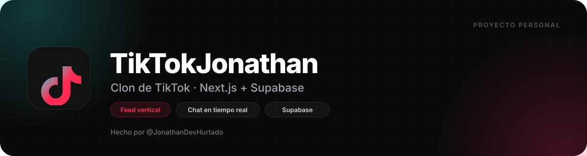

# 05 · Branding e identidad visual

Este documento define el nombre, el logo, la paleta, la tipografía, la voz y los patrones visuales del proyecto. Sirve para mantener la coherencia si añades pantallas, assets o contenido.

---

## 1. Identidad

| Campo | Valor |
| --- | --- |
| **Nombre del proyecto** | TikTokJonathan |
| **Nombre visible en la UI** | TikTok |
| **Slug / paquete** | `tiktokjonathan` |
| **Repositorio** | `TIKTOKJonathan` |
| **Tagline** | Clon de TikTok · Next.js + Supabase |
| **Tagline alternativa** | El feed vertical que construí para aprender full-stack |
| **Autor** | Jonathan Hurtado (@JonathanDevHurtado) |
| **Idioma** | Español |
| **Tipo de proyecto** | Proyecto personal / portafolio |
| **Personalidad** | Curiosa, directa, técnica, sin pretensiones |
| **Público** | Reclutadores, otros desarrolladores, amigos y curiosos |

### Qué transmite

- **Aprendizaje real:** no es una landing bonita, es una app con backend, seguridad y tiempo real.
- **Cercanía:** la interfaz habla en segunda persona, con mensajes claros y algún emoji.
- **Ambición:** replica flujos complejos (feed, chat, grupos, notificaciones) sin esconder las limitaciones.
- **Honestidad:** la documentación dice qué funciona, qué no y qué falta.

---

## 2. Logo

<p align="center">
  
</p>

### Descripción

Una **nota musical estilizada** construida con un trazo sólido, inspirada en el lenguaje visual de TikTok pero con identidad propia. El símbolo cabe en un cuadrado de 48 × 48 y funciona a tamaños pequeños porque no tiene detalles finos.

### Construcción

| Propiedad | Valor |
| --- | --- |
| `viewBox` | `0 0 48 48` |
| Tipo de relleno | Sólido con gradiente |
| Gradiente | `#25F4EE` → `#FE2C55` (50 %) → `#FE2C55` (100 %) |
| Dirección | Diagonal de arriba-izquierda a abajo-derecha (`x1=2 y1=8 x2=43 y2=48`) |
| Fondo | Transparente |

### Archivos

| Archivo | Uso |
| --- | --- |
| [`assets/logo.svg`](assets/logo.svg) | Logo principal con gradiente. |
| [`assets/logo-mono.svg`](assets/logo-mono.svg) | Versión monocroma roja para fondos claros o impresión. |
| [`../src/app/icon.svg`](../src/app/icon.svg) | Favicon y app icon de Next.js. |
| [`../src/components/Sidebar.jsx`](../src/components/Sidebar.jsx) | Logo inline de la barra lateral (mismo trazado). |
| [`../dist/favicon.svg`](../dist/favicon.svg) | Favicon del build estático. |

### Reglas de uso

**Sí:**
- Usar el logo completo, sin recortar.
- Mantener una zona de respeto equivalente al 25 % del ancho del símbolo.
- Tamaño mínimo: **24 px** en pantalla, **10 mm** en impresión.
- Sobre fondos oscuros (`#010101`, `#121212`) o claros (`#FFFFFF`), el gradiente funciona en ambos.
- Usar la versión monocroma cuando solo haya un color disponible.

**No:**
- Estirar, rotar o inclinar el símbolo.
- Cambiar el orden o los colores del gradiente.
- Añadir sombras, biseles o contornos exteriores.
- Ponerlo sobre fondos con poco contraste (rojo, cian, fotos recargadas).
- Usarlo como patrón repetido o marca de agua.

### Banner

<p align="center">
  
</p>

El banner de [`assets/banner.svg`](assets/banner.svg) se usa en el README. Combina el logo, el nombre, la tagline y tres *pills* con las características principales. Está pensado para GitHub, no para redes sociales.

---

## 3. Paleta de colores

### Colores de marca

| Color | Hex | Muestra | Uso |
| --- | --- | --- | --- |
| Rojo TikTok | `#FE2C55` |  | Acento principal, botones, likes, badges, foco. |
| Cian TikTok | `#25F4EE` |  | Solo en el gradiente del logo y detalles del logo. |
| Negro fondo | `#010101` |  | Fondo principal del tema oscuro. |
| Superficie oscura | `#121212` |  | Tarjetas, sidebar, inputs. |
| Gris texto | `#8A8A8E` |  | Texto secundario en oscuro. |
| Blanco | `#FFFFFF` |  | Texto principal en oscuro. |

### Tema claro

| Color | Hex | Muestra | Uso |
| --- | --- | --- | --- |
| Fondo claro | `#FFFFFF` |  | Fondo principal. |
| Superficie clara | `#F1F1F2` |  | Tarjetas y inputs. |
| Texto claro | `#161823` |  | Texto principal. |
| Texto secundario claro | `#51535D` |  | Texto secundario. |

### Variables CSS

```css
:root {
  --bg-primary: #010101;
  --bg-secondary: #121212;
  --text-primary: #ffffff;
  --text-secondary: #8a8a8e;
  --border-primary: rgba(255, 255, 255, 0.12);
}

.light {
  --bg-primary: #ffffff;
  --bg-secondary: #f1f1f2;
  --text-primary: #161823;
  --text-secondary: #51535d;
  --border-primary: rgba(22, 24, 35, 0.12);
}
```

### Tokens de Tailwind

Definidos en `src/index.css` dentro de `@theme`:

| Token | Valor | Clase |
| --- | --- | --- |
| `--color-tiktok-red` | `#fe2c55` | `bg-tiktok-red`, `text-tiktok-red` |
| `--color-tiktok-black` | `var(--bg-primary)` | `bg-tiktok-black` |
| `--color-tiktok-dark-hover` | `var(--bg-secondary)` | `bg-tiktok-dark-hover` |
| `--color-tiktok-gray` | `#8a8a8e` | `text-tiktok-gray` |
| `--color-tiktok-text` | `var(--text-primary)` | `text-tiktok-text` |

> **Nota:** `tiktok-cyan` se usa en algunas clases (`border-l-tiktok-cyan`, `text-tiktok-cyan`) pero **no está definido** como token. Esas clases no aplican color. Está documentado en [09 · Limitaciones](09-limitaciones-y-roadmap.md).

### Contraste y accesibilidad

- Blanco sobre `#FE2C55` tiene un contraste aproximado de **3.7:1**, suficiente para texto grande o negrita de 18.66 px, pero **insuficiente para texto normal** según WCAG AA. Los botones usan negrita; aun así, conviene revisar tamaños pequeños.
- `#8A8A8E` sobre `#010101` ronda **4.6:1**; úsalo para texto secundario, no para párrafos largos.
- `#FE2C55` sobre `#010101` ronda **5.1:1**; funciona para enlaces y énfasis.
- Para texto crítico sobre rojo, considera blanco en negrita ≥ 16 px o un rojo más oscuro.

---

## 4. Tipografía

### Familia

```css
font-family: 'Inter', -apple-system, BlinkMacSystemFont, 'Segoe UI', Roboto, Helvetica, Arial, sans-serif;
```

- **Inter** si está disponible en el sistema o se carga externamente.
- El proyecto **no importa Inter** desde Google Fonts ni `next/font`; usa la pila del sistema con Inter como primera opción.

### Escala

| Rol | Tamaño | Peso | Ejemplo |
| --- | --- | --- | --- |
| Display | `text-3xl` / `text-4xl` | 800–900 | Títulos de bienvenida. |
| H1 | `text-2xl` | 800–900 | "Mensajes", "Bandeja de entrada". |
| H2 | `text-xl` | 700–800 | Secciones de explorar. |
| H3 | `text-lg` | 700 | Nombres de grupo, títulos de tarjeta. |
| Cuerpo | `text-sm` / `text-base` | 400–500 | Descripciones, mensajes. |
| Etiqueta | `text-xs` | 600–700 | Stats, timestamps, badges. |
| Micro | `text-[10px]` | 600–700 | Contadores de badges. |

### Reglas

- Títulos con `tracking-tight` o `tracking-tighter` para un look compacto.
- Texto de cuerpo con `leading-relaxed` en chats y párrafos.
- No usar más de tres tamaños en una misma tarjeta.
- Evitar mayúsculas sostenidas; se reservan para etiquetas pequeñas (`uppercase tracking-wider`).

---

## 5. Espaciado, radios y sombras

| Elemento | Valor | Uso |
| --- | --- | --- |
| Espaciado base | 4 px (Tailwind `1`) | Escala estándar. |
| Padding de página | `p-4` móvil, `p-8` escritorio | Contenedores. |
| Gap de listas | `gap-2` a `gap-4` | Mensajes, tarjetas. |
| Radio pequeño | `rounded-md` | Inputs secundarios. |
| Radio medio | `rounded-xl` / `rounded-2xl` | Tarjetas, modales, inputs. |
| Radio completo | `rounded-full` | Botones, avatares, pills. |
| Sombra estándar | `shadow-lg` / `shadow-xl` | Botones flotantes, modales. |
| Sombra de marca | `shadow-tiktok-red/20` | Botones rojos y hover. |

### Jerarquía de superficies

1. **Fondo:** `--bg-primary`.
2. **Superficie:** `--bg-secondary` o `white/5`.
3. **Borde:** `--border-primary` o `white/10`.
4. **Acento:** rojo `#FE2C55`.

---

## 6. Movimiento

| Interacción | Duración | Curva | Implementación |
| --- | --- | --- | --- |
| Hover de botón | 200–300 ms | `ease` | `hover:scale-105` |
| Press | 150–200 ms | `ease` | `active:scale-95` |
| Aparición de modal | 200–300 ms | `ease-out` | `animate-in fade-in zoom-in-95` |
| Panel de comentarios | 300 ms | `ease-out` | `animate-slide-in-right` |
| Bottom sheet | 300 ms | `ease-out` | `animate-slide-up` |
| Corazón de like | 900 ms | — | `animate-ping` |
| Badge | 200 ms | `ease-out` | `animate-in zoom-in` |

No se respeta `prefers-reduced-motion`; es una mejora pendiente.

---

## 7. Iconografía

- Librería: [lucide-react](https://lucide.dev/).
- Tamaños: `w-4 h-4` (12–16 px visuales), `w-5 h-5`, `w-6 h-6`, `w-7 h-7`.
- Grosor: `strokeWidth={2}` normal, `2.5` en estados activos.
- Color: hereda `currentColor`; activo en rojo, inactivo en texto secundario.
- Iconos usados: `Home`, `Compass`, `User`, `Plus`, `LogIn`, `MessageSquare`, `Bell`, `Heart`, `MessageCircle`, `Share2`, `Bookmark`, `Volume2`, `VolumeX`, `Music`, `Play`, `X`, `Send`, `Trash2`, `Search`, `Users`, `Film`, `Hash`, `Sparkles`, `TrendingUp`, `Eye`, `Edit2`, `Camera`, `Loader2`, `Shield`, `ShieldOff`, `Sun`, `Moon`, `LogOut`, `AlertTriangle`, `MoreHorizontal`, `ChevronUp`, `ChevronDown`, `ChevronLeft`, `UserPlus`, `UserCheck`, `Settings`, `Image`, `Paperclip`, `LogOut`, `ShieldAlert`.

---

## 8. Voz y tono

### Principios

1. **Claro antes que ingenioso.** El usuario tiene que entender qué pasó.
2. **Segunda persona.** "Inicia sesión", "Sigue a tus creadores", "Tu perfil".
3. **Breve.** Los textos de UI no son párrafos.
4. **Cercano, sin exagerar.** Algún emoji en estados vacíos, ninguno en errores críticos.
5. **Sin jerga técnica en la interfaz.** "No se pudo subir el video", no "Error 413 Payload Too Large".

### Ejemplos

| Contexto | Texto actual | Por qué funciona |
| --- | --- | --- |
| Like sin sesión | "Inicia sesión para dar Like" | Acción clara y directa. |
| Feed vacío | "Aún no hay videos publicados" | No culpa al usuario. |
| Siguiendo vacío | "Sigue a tus creadores favoritos para ver sus videos aquí." | Explica cómo salir del estado. |
| Sin notificaciones | "Las notificaciones sobre likes, comentarios y seguidores aparecerán aquí." | Anticipa el comportamiento. |
| Sin comentarios | "Sé el primero en comentar." | Invita a la acción. |
| Chat vacío | "Empieza la conversación" + "Di hola a @usuario" | Personalizado y amable. |
| Error de subida | Mensaje de Supabase tal cual | Útil para depurar, poco amigable. |

### Emojis

- En estados vacíos y branding: 👥 🌊 🔥 ✨.
- En categorías: ⛩️ 🎨 🍳 🎮 etc.
- **No** en mensajes de error, botones críticos ni datos financieros.

---

## 9. Componentes visuales

### Botón primario

```html
<button class="bg-tiktok-red text-white font-bold py-2.5 px-8 rounded-full
               hover:bg-[#e0254b] hover:scale-105 active:scale-95
               transition-all shadow-lg shadow-tiktok-red/20">
  Seguir
</button>
```

- Fondo rojo, texto blanco, negrita.
- `rounded-full` salvo en formularios grandes, donde se usa `rounded-xl`.
- Hover: rojo más oscuro + escala 1.05.
- Press: escala 0.95.

### Botón secundario

- Fondo `white/5` o `black/5`.
- Borde `white/10` o `black/10`.
- Texto principal.
- Mismo radio y transición.

### Input

- Fondo `white/5` (oscuro) o `black/5` (claro).
- Borde `white/10` / `black/10`.
- `rounded-xl`, `px-4 py-3`.
- Focus: `ring-2 ring-tiktok-red/30 border-tiktok-red`.

### Tarjeta

- Fondo `#121212` (oscuro) o blanco (claro).
- Borde `white/10` / `black/10`.
- `rounded-2xl`, `shadow-xl`.
- Padding `p-4` a `p-8`.

### Pills de categoría

- `rounded-full`, `px-4 py-2`, texto `text-sm font-semibold`.
- Activa: fondo rojo, texto blanco, sombra roja.
- Inactiva: fondo `white/5`, borde `white/10`.

### Avatar

- `rounded-full`, `object-cover`.
- Borde 2 px blanco o rojo en hover.
- Tamaños: 32, 40, 48, 56, 96, 128 px.
- Fallback: DiceBear con el username como semilla.

### Navegación

- **Escritorio:** sidebar de 80 px (compacta) o 240 px (expandida), iconos + labels.
- **Móvil:** barra inferior de 64 px, cinco ítems, botón central de subida con acentos cian/rojo.
- **Chat:** se oculta la barra inferior para dar espacio al teclado.

---

## 10. Accesibilidad

### Lo que ya está bien

- `lang="es"` en `<html>`.
- La mayoría de imágenes tienen `alt`.
- Los inputs tienen `label` visible.
- Los botones usan elementos `<button>` reales.
- Hay estados de foco en inputs.
- Los tamaños táctiles principales rondan 44 px.

### Lo que falta

| Problema | Dónde | Recomendación |
| --- | --- | --- |
| Contraste insuficiente de blanco sobre rojo | Botones primarios | Usar texto ≥ 18.66 px en negrita o un rojo más oscuro. |
| Falta de `aria-label` en botones de icono | `VideoCard`, `Sidebar`, chats | Añadir `aria-label` descriptivo. |
| `div` clicables sin rol ni teclado | Tarjetas de video, perfiles, menús | Usar `<button>` o añadir `role="button"`, `tabIndex` y `onKeyDown`. |
| Sin `prefers-reduced-motion` | Animaciones globales | Envolver animaciones en una media query. |
| Videos sin subtítulos ni pista de audio | Feed | Añadir `<track kind="captions">` cuando haya contenido hablado. |
| Foco visible escaso en botones | Toda la UI | Añadir `focus-visible:ring-2`. |
| Modales sin trampa de foco | Comentarios, editar perfil, grupos | Gestionar foco y `Escape`. |

---

## 11. Assets y licencias

| Asset | Origen | Licencia |
| --- | --- | --- |
| Logo y banner | Creados para este proyecto a partir del SVG existente | Uso del proyecto. |
| Iconos | [Lucide](https://lucide.dev/) | ISC. |
| Avatares de ejemplo | [DiceBear](https://www.dicebear.com/) | CC BY 4.0 según el estilo. |
| Posters de ejemplo | [Picsum](https://picsum.photos/) | Imágenes de Unsplash/Pexels según el caso. |
| Videos de ejemplo | W3Schools | Solo para pruebas. |
| Tipografía Inter | Rasmus Andersson | SIL Open Font License. |

> TikTok es una marca registrada de ByteDance. Este proyecto no está afiliado ni respaldado por TikTok.

---

Siguiente: [06 · Desarrollo](06-desarrollo.md) · Volver al [índice](README.md).
